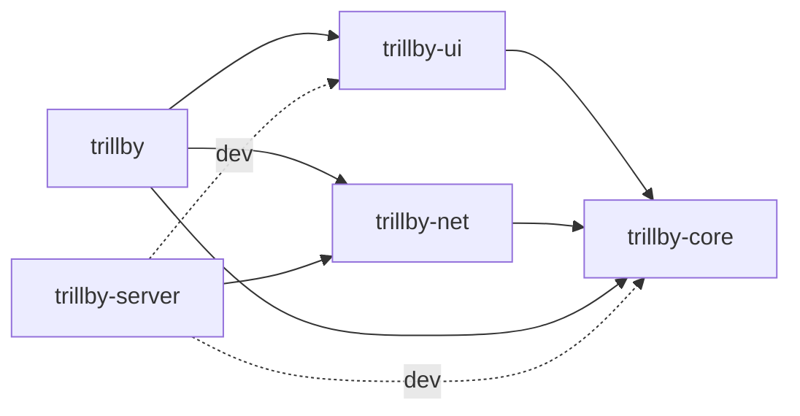

# Trillby Architecture

Cargo workspace (`Cargo.toml`, resolver 2, `panic = "abort"` in dev and release) of 5 crates: a handheld scanner client that runs as PID 1 on Linux, plus a floor-server log sink.

## Crates

| Crate | Role | std/no_std | Depends on |
|---|---|---|---|
| `trillby-core` | UI state machine, operator/job session FSM, shared geometry and events | `no_std` | `heapless` |
| `trillby-ui` | embedded-graphics renderer, theme, layout, widgets, keyboard grid | `no_std` | `trillby-core`, `embedded-graphics`, `heapless`; `embedded-graphics-framebuf` (used by tests/examples only) |
| `trillby-net` | encrypted binary transport: framing, own crypto, client/server, outbox, provisioning, POSIX sockets | `no_std` (`std` only under `cfg(test)`) | `trillby-core`, `heapless`, `libc` |
| `trillby` | device binary (PID 1): poll loop, evdev/serial input, `/dev/fb0` output | `no_std` + `no_main` (musl `crt1` → `main`) | `trillby-core`, `trillby-ui`, `trillby-net`, `embedded-graphics`, `embedded-graphics-framebuf`, `heapless`, `libc` |
| `trillby-server` | floor server: accepts clients, logs every event to stdout | `std` | `trillby-net`, `heapless`, `libc`; dev: `trillby-core`, `trillby-ui`, `embedded-graphics`, `embedded-graphics-framebuf`, `tempfile` |

## Dependency graph

## Runtime flows

**Boot:** kernel execs /init → `main` (`crates/trillby/src/main.rs`) → `run_app` → `init::setup_pid1` (mount pseudo-fs, `hw::configure_network`, `console::enter_graphics_mode`) → poll loop; credentials from `DeviceProvisioning::load_from_file` (/etc/trillby/device.key), else dev fallback.

**Input → UiState → render** (`run_app` loop, one `libc::poll` with `POLL_TIMEOUT_MS`):
- Monotonic clock: `now_ms = monotonic_ms()`; `UiState::set_now_ms(now_ms)` tracks wall-clock time and triggers 1 Hz refresh on second rollover.
- Readable fds → `hw::Hardware::handle_poll` → `DeviceAdapter::handle_fd` (adapter is `crates/trillby/src/hw/qemu.rs` or `crates/trillby/src/hw/device.rs`), then `EvdevTouch::handle_fd` and `finish_poll_step`.
- evdev touch (/dev/input/event*) → `DeviceAdapter::scale_touch` + `KeyboardGrid::resolve_key` → `UiEvent::TouchDown`/`TouchMove`/`TouchUp`.
- `qemu-sim` serial (/dev/ttyAMA0): `rfid`/`barcode` → `UiEvent::RfidScanned`/`BarcodeScanned`; `type` → `UiState::apply_key`; `click` → touch events; `scale` sets the raw touch range.
- `UiState::handle_event` → `OperatorSession::handle_rfid`/`handle_barcode`/`force_*`, sets `UiState::dirty`.
- When `dirty`: `UiRenderer::render` draws into an 800×480 `Rgb565` `FrameBuf` → `FramebufferWriter::write_frame` (/dev/fb0, 16 or 32 bpp).

**Session event → outbox → NetClient → NetServer → server log:**
- `OperatorSession` queues `SessionEvent` → `run_app` drains `UiState::pop_session_event`.
- `SessionEvent` → `NetClient::send_session_event`: encodes `AuthInitPayload` or `WorkEventPayload` into the outbox via `send_payload`; every 10 s while `Online` → periodic `HeartbeatPayload` via `send_payload`.
- All `send_*` → `enqueue_event` → `Outbox::push` (fixed ring, `NetClient<32>`).
- `NetClient::poll_step` → `poll_step_with` drives Disconnected → Connecting → Handshaking → Online. Handshake: `send_handshake_init` (HMAC via `pack_and_authenticate_hmac`) ↔ `NetServer::handle_session_handshake` (PSK from the server resolver, `derive_session_key`).
- Online: `flush_outbox` seals the head with `pack_and_encrypt_directed`; one frame in flight (stop-and-wait, `ACK_TIMEOUT_MS`).
- `trillby-server` `main` polls listener + clients → `NetServer::poll_step_with` → `dispatch_session_frames`: `decrypt_and_unpack`, auto-ACK (`AckPayload`), then `ServerEvent::Data`/`Connected`/`Disconnected`.
- `log_event` prints timestamped `CONNECT`/`AUTH`/`WORK_START`/`WORK_STOP`/`LOGOUT`/`HEARTBEAT`/`DATA`/`DISCONNECT` lines to stdout; PSKs come from `load_registry` (`--registry`) and/or `--dev`.
- Client `dispatch_buffered_frames` matches the ACK → `Outbox::pop`. Status changes from `poll_step` → `UiEvent::NetworkStatusChanged`; `UiState::pending_outbox_count` mirrors `outbox_pending_count`.

## Modules

### trillby-core
- `crates/trillby-core/src/lib.rs` — crate root: re-exports, poll cadence constants; key: `POLL_FREQ_HZ`, `POLL_TIMEOUT_MS`
- `crates/trillby-core/src/state.rs` — UI state machine: touch/scan/net events → screen, keyboard, input buffer, event log; key: `UiState`, `handle_event`
- `crates/trillby-core/src/session.rs` — operator login/logout and job start/stop FSM queuing telemetry events; key: `OperatorSession`, `SessionEvent`
- `crates/trillby-core/src/event.rs` — input events produced by hardware adapters; key: `UiEvent`
- `crates/trillby-core/src/header.rs` — fixed header/debug button rects and hit-testing shared with the renderer; key: `HeaderButton::at`, `DebugButton::at`
- `crates/trillby-core/src/geometry.rs` — minimal point/rect with overflow-safe half-open containment; key: `Rect`, `Rect::contains`
- `crates/trillby-core/src/keyboard_types.rs` — virtual key and keyboard layer types; key: `Key`, `KeyboardLayer::toggled`
- `crates/trillby-core/src/net_types.rs` — network connection status displayed by the UI; key: `NetworkStatus`

### trillby-ui
- `crates/trillby-ui/src/lib.rs` — crate root: module declarations and flat re-exports; key: `UiRenderer`, `KeyboardGrid`, `SCREEN_PIXELS`, `ScreenPixels`
- `crates/trillby-ui/src/view.rs` — whole-frame renderer per screen/session state, core↔embedded-graphics geometry conversions; key: `UiRenderer::render`, `core_rect_to_eg`, `eg_rect_to_core`
- `crates/trillby-ui/src/layout.rs` — splits screen into content area and optional bottom keyboard area, defines screen dimensions and pixel buffer type; key: `LayoutZones::compute`, `KEYBOARD_HEIGHT`, `SCREEN_PIXELS`, `ScreenPixels`
- `crates/trillby-ui/src/keyboard_grid.rs` — const keyboard layers, rebindable spare keys, cell geometry, hit-testing; key: `KeyboardGrid::slots`, `KeyboardGrid::resolve_key`, `SPECIAL_BINDINGS`
- `crates/trillby-ui/src/theme.rs` — semantic colours, radii, spacing, fonts as default trait methods; key: `Theme`, `DarkFloorTheme`
- `crates/trillby-ui/src/widgets/mod.rs` — widget module root and re-exports; key: `Button`, `Badge`, `Card`, `TextField`
- `crates/trillby-ui/src/widgets/button.rs` — rounded button, variant×pressed colour table, centred clipped label; key: `Button::draw`, `ButtonVariant`
- `crates/trillby-ui/src/widgets/badge.rs` — auto-sized pill status label coloured by variant; key: `Badge::draw`, `BadgeVariant`
- `crates/trillby-ui/src/widgets/card.rs` — rounded surface panel with optional title and divider; key: `Card::draw`
- `crates/trillby-ui/src/widgets/text_field.rs` — input box showing value or placeholder, focus-highlighted border; key: `TextField::draw`

### trillby-net
- `crates/trillby-net/src/lib.rs` — `#![no_std]` crate root; flat re-export of the public API; key: `NetClient`, `NetServer`
- `crates/trillby-net/src/framing.rs` — frame reassembly buffer and session cryptographic state; key: `FrameAssembler`, `SessionCrypto`, `RecvOutcome`
- `crates/trillby-net/src/packet.rs` — 16-byte LE header, payload structs, HMAC/AEAD frame seal/open, key derivation; key: `FrameHeader`, `pack_and_encrypt_directed`, `decrypt_and_unpack`, `derive_session_key`
- `crates/trillby-net/src/client.rs` — device-side connect/handshake/online FSM with backoff, stop-and-wait ACK, replay check; key: `NetClient::poll_step_with`, `NetClient::wait_and_step_with`, `ClientState`
- `crates/trillby-net/src/server.rs` — fixed-slot multi-client server: accept, HMAC handshake, decrypt, auto-ACK, events; key: `NetServer::poll_step_with`, `ServerEvent`
- `crates/trillby-net/src/outbox.rs` — fixed-capacity ring of plaintext events sealed only at transmit time; key: `Outbox`, `MAX_EVENT_LEN`
- `crates/trillby-net/src/provisioning.rs` — 63-byte `TRPV` credential blob with CRC32, loaded via raw syscalls; key: `DeviceProvisioning::load_from_file`, `crc32_ieee`
- `crates/trillby-net/src/posix.rs` — non-blocking IPv4 TCP socket, getrandom, monotonic clock behind private `sys` facade; key: `PosixSocket`, `fill_random`, `monotonic_ms`
- `crates/trillby-net/src/crypto/mod.rs` — crypto facade: re-exports, constant-time compare, volatile secret wipe; key: `Pod`, `constant_time_eq`, `wipe`
- `crates/trillby-net/src/crypto/sha256.rs` — streaming SHA-256 with rolling 16-word schedule; key: `Sha256`, `sha256`
- `crates/trillby-net/src/crypto/hmac.rs` — HMAC-SHA256 with precomputed ipad/opad states; key: `HmacSha256`, `hmac_sha256`
- `crates/trillby-net/src/crypto/hkdf.rs` — HKDF extract/expand over keyed HMAC copies; key: `hkdf_extract`, `hkdf_expand`
- `crates/trillby-net/src/crypto/chacha20.rs` — ChaCha20 block function and in-place keystream XOR with wrap guard; key: `chacha20_block`, `chacha20_xor`
- `crates/trillby-net/src/crypto/poly1305.rs` — radix-2^64 Poly1305 one-time MAC with u128 products; key: `Poly1305`
- `crates/trillby-net/src/crypto/aead.rs` — RFC 8439 ChaCha20-Poly1305 seal/open, in place; key: `chacha20_poly1305_encrypt`, `chacha20_poly1305_decrypt`

### trillby
- `crates/trillby/src/main.rs` — C `main` entry, panic handler, boot banner, provisioning fallback, poll loop; key: `run_app`, `BufferWriter`, `raw_print`
- `crates/trillby/src/init.rs` — PID-1 bring-up: mount proc/sys/devtmpfs, `lo` via ioctl, errno logging; key: `setup_pid1`, `configure_ipv4_iface`, `log_errno`
- `crates/trillby/src/console.rs` — switch active VT to graphics mode so fbcon stops drawing; key: `enter_graphics_mode`
- `crates/trillby/src/fb.rs` — lazy `/dev/fb0` open, RGB565 write or BGRX-32 conversion, reopen on error; key: `FramebufferWriter::write_frame`
- `crates/trillby/src/hw/mod.rs` — hardware facade; picks adapter module by feature, dispatches readable fds; key: `Hardware::handle_poll`
- `crates/trillby/src/hw/evdev.rs` — scans `/dev/input/event0..9`, decodes ABS/REL/BTN events into touch events; key: `EvdevTouch::handle_fd`, `finish_poll_step`
- `crates/trillby/src/hw/device.rs` — physical adapter: no extra fds, 1:1 touch clamp to 800×480; key: `DeviceAdapter::scale_touch`
- `crates/trillby/src/hw/qemu.rs` — `qemu-sim` adapter: `/dev/ttyAMA0` command injection, SLIRP `eth0`, tablet scaling; key: `DeviceAdapter::handle_fd`, `default_server_ip`

### trillby-server
- `crates/trillby-server/src/main.rs` — CLI, registry loading, blocking poll loop, event-to-log-line formatting; key: `Registry`, `load_registry`, `log_event`, `main`

## Patterns

State and data:
- Data-carrying state enums — `SessionState`, `ClientState::Disconnected { next_attempt_ms, backoff_ms }` — illegal states unrepresentable; timing lives in state
- Fixed-capacity, const-generic storage — `heapless::String`/`Vec`, `UiState<N>`, `NetClient<OUTBOX_CAP>`, `NetServer<MAX_CLIENTS>`, `Outbox<CAP>`, `Registry` — `no_std`, no allocator, caller sizes static storage
- Truncate-instead-of-drop text — `to_bounded_string`, `Truncating` (core), `BufferWriter` (trillby) — keep prefix of overlong ids, logs, paths
- Full-id hash beside truncated id — `identifier_key` (FNV-1a) — distinguish ids sharing a truncated prefix
- Event queue drained by caller — `OperatorSession::events` / `UiState::pop_session_event` — decouples session FSM from network I/O
- Dirty flag — `UiState::dirty` — render only when state changed
- Arm-on-press, fire-on-release buttons — `UiState::pressed_debug` — dragging off cancels a debug action

Geometry and rendering:
- One geometry source for drawing and hit-testing — `header.rs` rects, `KeyboardGrid::slots` — drawn and tappable areas cannot drift
- Compile-time layout validation — `layout_is_valid` `const _: () = assert!` — every keyboard row spans exactly `COLS`
- Const data tables with `const fn` builders — `ALPHA`, `SYMBOLS`, `ch`/`wide`/`special` — keyboard layout as static data
- Indirected spare keys — `Key::Special(i)` → `SPECIAL_BINDINGS` — rebind keys without touching layouts
- Theme trait with default methods — `Theme`, `impl Theme for DarkFloorTheme {}` — zero-cost styling, override per theme
- Consuming builder widgets — `Button::new(..).variant(..).pressed(..).draw(..)` — terse immediate-mode widget calls
- Generic `DrawTarget<Color = Rgb565>` — `UiRenderer::render`, widget `draw` — same code for framebuffer, tests, PPM dump
- Clipped sub-targets — `target.clipped(..)` in `render`, `Button::draw` — text never paints outside its box

I/O and process model:
- Caller-driven poll step, no threads — `run_app`, `NetClient::poll_step_with` / `NetClient::wait_and_step_with`, `NetServer::poll_step_with` — everything embeds in PID 1's single `poll` loop
- Externally driven blocking poll — trillby-server `main` — avoids `NetServer::step`'s 0 ms busy-spin
- Compile-time adapter swap — `#[cfg_attr(feature = "qemu-sim", path = "qemu.rs")]` in `hw/mod.rs` — same API, no runtime dispatch
- Fd-ownership dispatch returning `bool` — `DeviceAdapter::handle_fd`, `EvdevTouch::handle_fd` — first owner consumes readiness
- Syscall facade — `posix::sys`, `cvt_int`/`cvt_ssize` — errno→`Result` centralised (`TCP_NODELAY`, provisioning I/O bypass it)
- Raw `libc` syscalls and `#[repr(C)]` kernel structs — `fb.rs`, `init.rs`, `console.rs`, `evdev.rs`; `FbVarScreeninfo`, `IfreqAddr`, `InputEvent` — direct ioctl/read ABI
- PID-1 guard — `setup_pid1` checks `getpid() == 1` — binary still runs from a dev shell
- Lazy open with retry and one-shot notice — `FramebufferWriter::open_fb` — tolerate late `/dev/fb0`
- RAII cleanup — `impl Drop for PosixSocket`, `PipeFds`/`ServerProcess`/`NamedTempFile` in tests — fds closed, children killed, temp files removed
- Closure PSK resolver — `resolver` in trillby-server `main` — keeps registry storage out of the transport
- Allocation-free logging through `impl Write` — `ts`, `hex`, `bytes`, `log_event` — writes straight to locked stdout
- Boxed server — `Box<NetServer<MAX_CLIENTS>>` — keeps the large struct off the stack

Protocol:
- Seal-at-transmit plaintext outbox — `Outbox`, `NetClient::flush_outbox` — queued events survive reconnects and new session keys
- Stop-and-wait with ACK timeout — `Inflight`, `ACK_TIMEOUT_MS` — one unacked frame; dead links torn down
- Exponential reconnect backoff — `transition_to_disconnected` (1 s → 30 s cap) — avoid hammering an unreachable server
- HMAC handshake, AEAD data frames — `pack_and_authenticate_hmac`, `pack_and_encrypt_directed` — no nonce reuse before the session key exists
- Header as AAD, direction bit in nonce — `FrameHeader::derive_nonce`, `FLAG_CLIENT_TO_SERVER` — directions never share keystream; header tamper-proof
- Monotonic `seq_num` anti-replay — `rx_seq` in `NetClient`/`ServerSession` — drop replayed or reordered frames
- Bounded reassembly buffer + recv cap — `rx_buf: [u8; MAX_FRAME_LEN * 2]`, `MAX_RECV_PER_STEP` — no overflow, no UI starvation
- Sequential slice codec — `ByteWriter` / `ByteReader` — bounds-checked LE encoding without allocation
- CSPRNG with deterministic fallback — `fill_random` → `generate_client_nonce` / SHA-256 seed — handshake proceeds without getrandom

Crypto:
- One file per primitive behind a facade — `crypto/mod.rs` — callers import `crate::crypto::{…}` only
- Caller-provided buffers, in-place encryption with trailing tag — all public fns, `aead.rs` — no heap, frame buffer reused
- Volatile zeroization — `unsafe trait Pod` + `wipe`; `Drop` wipe in `Poly1305` and `HmacSha256` vs `Copy` + manual `wipe()` in `Sha256` — secrets not left in memory
- Constant-time compare and select — `constant_time_eq`, `Poly1305::finalize` — no secret-dependent branches
- Streaming `new`/`update`/`finalize` plus one-shot wrapper — `Sha256`, `HmacSha256`, `Poly1305` — incremental and simple APIs
- Overflow guards returning `Err(CryptoError)` — `chacha20_xor`, `hkdf_expand` — refuse keystream reuse / RFC length limits

## Tests & tooling

- Unit tests: a `#[cfg(test)] mod tests` at the end of most source files; `trillby-net` crypto tests use the `#[cfg(test)] hex` helper in `crates/trillby-net/src/crypto/mod.rs` with RFC vectors.
- Integration tests: `crates/trillby-net/tests/integration.rs` (client↔server over loopback), `crates/trillby-ui/tests/ui_integration.rs` (render lifecycle), `crates/trillby-server/tests/e2e.rs` (real `trillby-server` process or in-process `NetServer` against a `SimulatedDevice`, synthetic clock); shared test support in `crates/trillby-net/tests/support/mod.rs` and `crates/trillby-ui/tests/support/mod.rs`.
- Examples: `crates/trillby-ui/examples/render_to_image.rs` (PPM screenshot), `crates/trillby-net/examples/provision.rs` (writes device.key, appends to the server registry), `crates/trillby-server/examples/fake_client.rs` (smoke client with dev credentials).
- Feature `qemu-sim` (`crates/trillby/Cargo.toml`): `crates/trillby/src/hw/mod.rs` picks `qemu.rs` (serial commands, SLIRP eth0 10.0.2.15, virtio-tablet scaling, server 10.0.2.2 when PID 1) instead of `device.rs` (1:1 touch clamp, server 127.0.0.1).
- `.cargo/config.toml`: `aarch64-unknown-linux-musl` linker, static-link rustflags, runner `qemu-aarch64`.
- `scripts/build_kernel.sh` <linux-tree>: detects a GCC or Clang toolchain and builds an RPi Zero 2 W arm64 kernel (Image, modules, dtbs) from `kernel/rpi_zero2w_defconfig`.
- `scripts/run_qemu_system.sh`: `cargo build -Z build-std` for musl with `--features qemu-sim`, packs the binary as /init into an initramfs, boots `qemu-system-aarch64 -M virt` at 800x480 (virtio-gpu, tablet, net; serial on stdio).
- `scripts/provision_device.sh`: wrapper for `cargo run -p trillby-net --example provision`.
- `scripts/run_host_tests.sh`: runs on the host: `cargo test --workspace`, then provision → `trillby-server` on port 18088 → `fake_client`, grepping the log for AUTH/WORK_START/WORK_STOP/LOGOUT/HEARTBEAT.
- `scripts/coverage.sh`: runs instrumented `--workspace` and `-p trillby --features qemu-sim` tests via `llvm-profdata` / `llvm-cov`, writes `target/coverage/summary.md`, and enforces `COVERAGE_FLOOR`.
